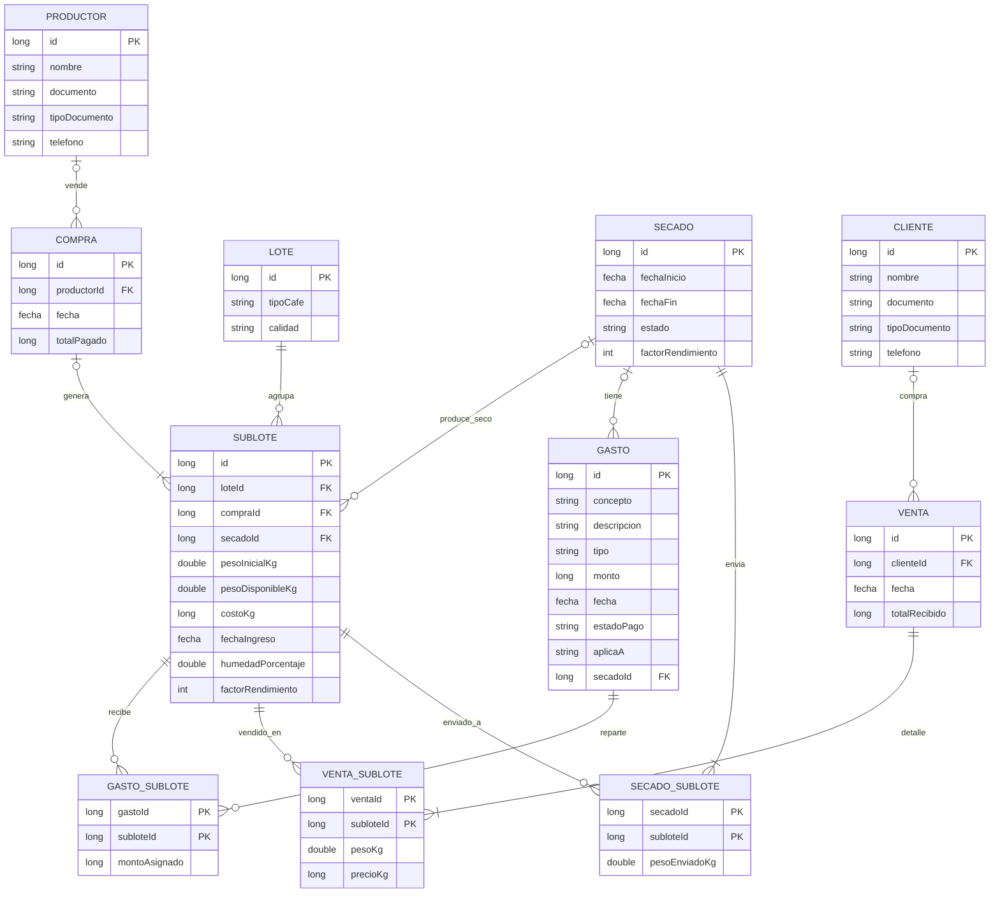

# Café Smart · Modelo de datos

**Código:** `app/src/main/java/com/cafesmart/app/data/model/`

## 1. Entidades

| Entidad | Qué representa |
|---|---|
| **Productor** | Quien vende café. Cédula o NIT únicos.|
| **Lote** | Agrupación lógica por *tipo + calidad*. No guarda pesos; se calculan desde sus sublotes. |
| **Sublote** | Unidad real del inventario: peso, costo/kg, fecha de entrada, humedad (8–15 %) y factor de rendimiento (70–140), ambos opcionales. |
| **Compra** | Operación de compra. Una compra → N sublotes (un "Café N" = un sublote). |
| **Gasto** | Concepto, descripción, tipo, monto, fecha, estado de pago, a qué aplica. | 
| **Venta** | Operación de venta, total o parcial, de varios sublotes a la vez. |
| *Cliente* (apoyo) | A quién se vende. |
| *Secado* (apoyo) | Convierte verde en seco y origina la merma. |
| *GastoSublote, VentaSublote, SecadoSublote* | Tablas intermedias (muchos a muchos con datos propios). |

## 2. Relaciones

| Relación | Cardinalidad | Cómo se guarda |
|---|---|---|
| Productor → Compra | 1 a N (opcional) | `Compra.productorId`, `null` = compra "Sin registrar" |
| Compra → Sublote | 1 a N | `Sublote.compraId` |
| Lote → Sublote | 1 a N | `Sublote.loteId` |
| Secado → Sublote (secos resultantes) | 1 a N | `Sublote.secadoId` (compraId o secadoId, **uno solo** tiene valor) |
| Gasto ↔ Sublote | N a M | `GastoSublote(gastoId, subloteId, montoAsignado)` |
| Venta ↔ Sublote | N a M | `VentaSublote(ventaId, subloteId, pesoKg, precioKg)` |
| Cliente → Venta | 1 a N (opcional) | `Venta.clienteId`, `null` = venta "Sin registrar" |
| Secado ↔ Sublote (verdes enviados) | N a M | `SecadoSublote(secadoId, subloteId, pesoEnviadoKg)` |
| Secado → Gasto | 1 a N (opcional) | `Gasto.secadoId` cuando `aplicaA == SECADO` |

## 3. Decisiones de diseño (y por qué)

1. **Sublote es la unidad; Lote solo agrupa.** El tipo y la calidad viven únicamente en `Lote`, así un sublote no puede contradecir a su lote. Al registrar una compra: buscar el lote (tipo, calidad) y crearlo si no existe.
2. **Nada derivado se guarda.** Peso total del lote, merma (kg, % y $), valor en bodega, subtotales y estado "agotado" se calculan al leer (propiedades en las data classes). Así no se desactualizan.
3. **Excepción: `Compra.totalPagado` y `Venta.totalRecibido` sí se guardan** como "foto" de lo confirmado (RF-13, RN-V-18: trazabilidad; "ingresos y salidas no deben modificarse").
4. **Venta y Gasto con tabla intermedia.** El Figma permite vender varios sublotes en una venta, cada uno con su kg y su precio, y asociar un gasto a varios sublotes. `montoAsignado` evita la duda de si el gasto cuenta completo en cada sublote.
5. **"Sin registrar" = FK nula**, no un productor ficticio (Tony Café no registra nombre ni cédula, RN-V-01).
6. **Dinero en `Long` (pesos enteros), kg en `Double`.** La app ya fuerza precios enteros; con `Long` los totales no pierden centavos.
7. **Fechas con la clase `Fecha` existente** (minSdk 24, sin `LocalDate`). Para Room: convertir con `fechaAMilis` / `milisAFecha`, que ya están en `Formatters.kt`.
8. **Sin anotaciones de Room todavía.** Los ids (`Long = 0`) y las relaciones por FK están listos para `@PrimaryKey(autoGenerate = true)`, `@ForeignKey` y `@Relation` el 19 nov. Las clases `*ConSublotes` / `*ConDetalle` son las vistas de lectura que Room llenará con `@Relation`.

## 4. Reglas que el modelo valida

Las data classes validan al construirse (`init { require(...) }`); un dato inválido lanza `IllegalArgumentException`.

| Entidad | Regla |
|---|---|
| Sublote | `compraId` o `secadoId`, nunca los dos · `pesoInicialKg > 0` · `0 ≤ pesoDisponibleKg ≤ pesoInicialKg` · `costoKg ≥ 0` · humedad entre **8 y 15 %** · factor entre **70 y 140** |
| Secado | EN_CURSO no tiene `fechaFin` · factor entre 70 y 140 |
| SecadoSublote | `pesoEnviadoKg > 0` |
| Gasto | `concepto` no vacío · `monto > 0` · `secadoId != null` si y solo si `aplicaA == SECADO` |
| GastoSublote | `montoAsignado > 0`; `Gasto.repartoEsValido(reparto)` comprueba que la suma sea igual al monto |
| Compra / Venta | `totalPagado` / `totalRecibido` ≥ 0 |
| VentaSublote | `pesoKg > 0` y `precioKg > 0` |

Las constantes de rango están en `Sublote.kt` (`HUMEDAD_MIN/MAX_PORCENTAJE`, `FACTOR_RENDIMIENTO_MIN/MAX`).

## 5. Observaciones

- `Calidad`, `TipoDocumento` y `Fecha` ahora **viven en `data/model`** (antes estaban en `data/purchase`), así el modelo no depende del paquete del formulario.
- **Nombres sin choque:** se borró el `Productor` viejo de `data/purchase` (el formulario usa el de `data.model`, con `id = 0` por defecto) y el `Sublote` viejo pasó a llamarse `CafeValidado`.
- **`tiposCafe`** (lista de textos del formulario) se arma desde el enum `TipoCafe`: hay una sola fuente. `TipoCafe.desdeEtiqueta("Verde")` convierte el texto al enum.
- **Dinero:** el formulario aún usa `Double` (`CafeValidado.precioKg`); el modelo usa `Long`. Convertir siempre con `Double.aPesos()` (redondea al peso más cercano).
- **Merma:** `SecadoConDetalle.mermaPorcentaje` usa `calcularMermaPorcentaje`. Sin kg enviados devuelve `0.0` (la función exige `kgInicial > 0`).
- **Al confirmar una compra (paso 3)** el ViewModel haría: productor (o `null`) → `Compra` → por cada `CafeValidado`: buscar/crear `Lote` → `Sublote(pesoInicialKg = pesoDisponibleKg = peso, costoKg = precio.aPesos())`.
- **Pendiente de confirmar con el equipo:** la regla de reparto de un gasto entre sublotes (hoy se propone en proporción a los kg). El modelo solo valida que la suma coincida con el monto.

## 6. Verificación

Los archivos del paquete `data/model` compilan con la versión de Kotlin del proyecto y la suite de pruebas completa pasa (`./gradlew testDebugUnitTest`). Las pruebas del modelo reproducen las cifras del Figma: secado 290 kg → 270 kg secos, merma 20 kg (6,9 %), valor de la merma $ 280.000; sublote de 120 kg × $ 14.000 = $ 1.680.000; venta de 150 kg × $ 20.000 = $ 3.000.000.
